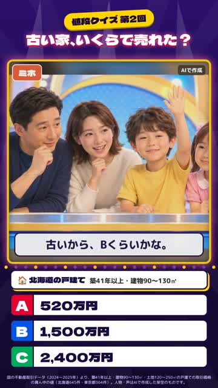
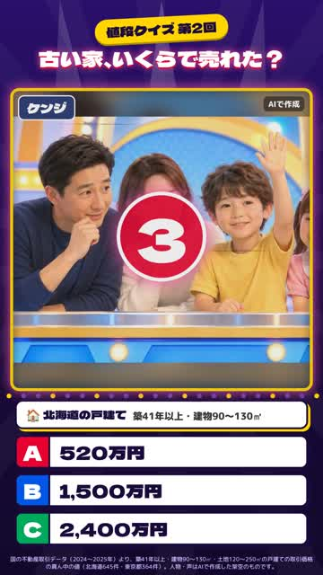
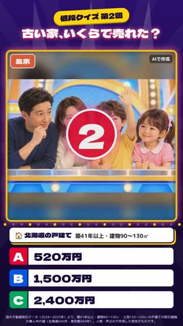
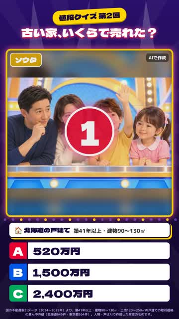
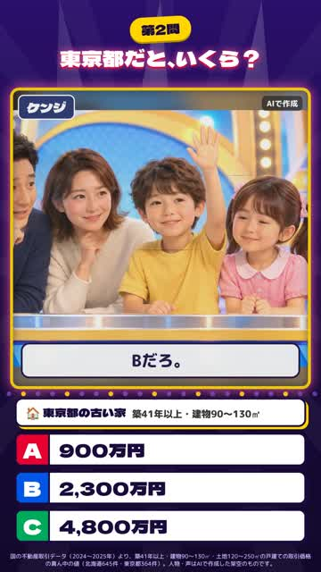
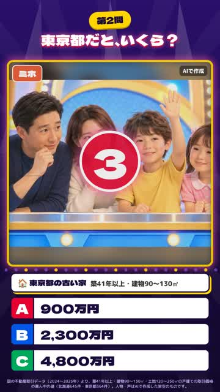
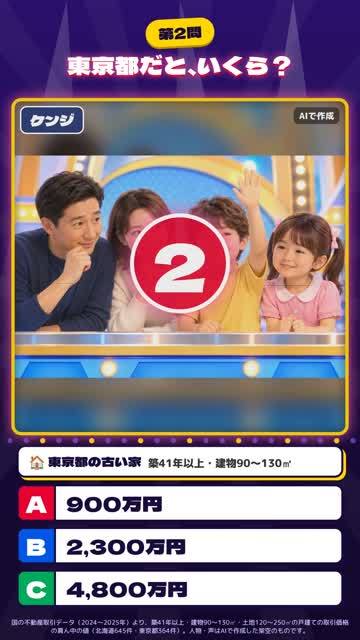
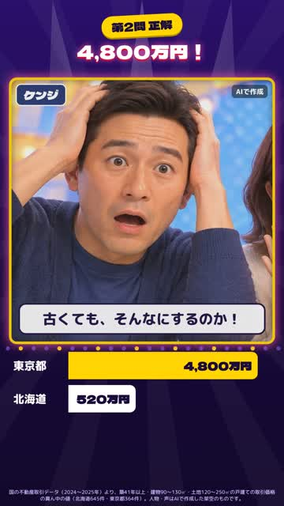

# 4. 絵コンテ：値段クイズ 第2回「古い家、いくらで売れた？」

全体：本編 55.0 秒 ＋ 最後のチェッカーの紹介 5 秒。1秒25コマ。曲は「昼下がり気分 / KK（OpenTracks）」を小さく、最初から最後まで。
見本の絵は、今の見本（ops/sns/drafts/2026-11-18/Q02.mp4）から各カットを切り出したもの。人物の場面は、のぼるさんのパソコンで自然な動きに作り直す。

| カット | 秒 | 画面（誰が・何を・カメラ） | セリフ | 下の文字 | 音 | 見本 |
|---|---|---|---|---|---|---|
| 1 | 0.0〜5.7 | 司会者のアップ。ゆっくり寄る。話す口と頭が動く | 司会「値段クイズ！ 北海道の、築41年以上の家。いくらで売れたでしょう？」 | 問題1と選択肢 A/B/C | シュッ |  |
| 2 | 5.7〜11.0 | 司会者のアップ。ゆっくり寄る。話す口と頭が動く | 司会「A 520万円／B 1,500万円／C 2,400万円！」 | 問題1と選択肢 A/B/C |  |  |
| 3 | 11.0〜13.6 | 家族4人（相談の絵）、ソウタのほうへゆっくり寄る。ソウタの口が動き、ほかの3人もまばたき・うなずき | ソウタ「C！ 家だもん、高いでしょ！」 | 問題1と選択肢 A/B/C |  |  |
| 4 | 13.6〜16.0 | 家族4人（相談の絵）、ミホのほうへゆっくり寄る。ミホの口が動き、ほかの3人もまばたき・うなずき | ミホ「古いから、Bくらいかな。」 | 問題1と選択肢 A/B/C |  |  |
| 5 | 16.0〜17.6 | 家族4人（相談の絵）、ケンジのほうへゆっくり寄る。ケンジの口が動き、ほかの3人もまばたき・うなずき | ケンジ「いや、Aじゃないか？」 | 問題1と選択肢 A/B/C |  |  |
| 6 | 17.6〜18.3 | 家族4人（相談の絵）を少しずつ寄る。大きな数字「3」 | （なし） | 問題1と選択肢 A/B/C | カチッ |  |
| 7 | 18.3〜19.0 | 家族4人（相談の絵）を少しずつ寄る。大きな数字「2」 | （なし） | 問題1と選択肢 A/B/C | カチッ |  |
| 8 | 19.0〜19.7 | 家族4人（相談の絵）を少しずつ寄る。大きな数字「1」 | （なし） | 問題1と選択肢 A/B/C | カチッ |  |
| 9 | 19.7〜22.8 | 司会者のアップ。ゆっくり寄る。話す口と頭が動く | 司会「正解は、A！ 520万円です！」 | 選択肢の正解が光る | ピンポン＋紙吹雪 |  |
| 10 | 22.8〜24.2 | 家族の大喜びの絵、ケンジに少し寄る | ケンジ「よし、当たった！」 | 選択肢の正解が光る |  |  |
| 11 | 24.2〜26.3 | 家族のびっくりの絵、ミホに少し寄る | ミホ「そんなに安いの？」 | 選択肢の正解が光る |  |  |
| 12 | 26.3〜34.3 | 司会者のアップ。ゆっくり寄る。話す口と頭が動く | 司会「第2問！ 同じくらい古い家、東京都だと？」 | 問題2と選択肢 A/B/C | シュッ |  |
| 13 | 34.3〜35.4 | 家族4人（相談の絵）、ハナのほうへゆっくり寄る。ハナの口が動き、ほかの3人もまばたき・うなずき | ハナ「A！」 | 問題2と選択肢 A/B/C |  |  |
| 14 | 35.4〜36.2 | 家族4人（相談の絵）、ケンジのほうへゆっくり寄る。ケンジの口が動き、ほかの3人もまばたき・うなずき | ケンジ「Bだろ。」 | 問題2と選択肢 A/B/C |  |  |
| 15 | 36.2〜38.2 | 家族4人（相談の絵）、ミホのほうへゆっくり寄る。ミホの口が動き、ほかの3人もまばたき・うなずき | ミホ「もしかして、C？」 | 問題2と選択肢 A/B/C |  |  |
| 16 | 38.2〜38.9 | 家族4人（相談の絵）を少しずつ寄る。大きな数字「3」 | （なし） | 問題2と選択肢 A/B/C | カチッ |  |
| 17 | 38.9〜39.6 | 家族4人（相談の絵）を少しずつ寄る。大きな数字「2」 | （なし） | 問題2と選択肢 A/B/C | カチッ |  |
| 18 | 39.6〜40.3 | 家族4人（相談の絵）を少しずつ寄る。大きな数字「1」 | （なし） | 問題2と選択肢 A/B/C | カチッ |  |
| 19 | 40.3〜45.3 | 司会者のアップ。ゆっくり寄る。話す口と頭が動く | 司会「正解は、C！ 4,800万円。北海道の9倍以上！」 | 答えの棒グラフ | ピンポン＋紙吹雪 |  |
| 20 | 45.3〜47.7 | 家族のびっくりの絵、ケンジに少し寄る | ケンジ「古くても、そんなにするのか！」 | 答えの棒グラフ |  |  |
| 21 | 47.7〜50.6 | 家族4人（相談の絵）、ミホのほうへゆっくり寄る。ミホの口が動き、ほかの3人もまばたき・うなずき | ミホ「土地の値段が、大きいのかもね。」 | 「気になる家の値段」の札 |  |  |
| 22 | 50.6〜55.0 | 司会者のアップ。ゆっくり寄る。話す口と頭が動く | 司会「何問正解できたかな？ コメントで教えてね！」 | 「気になる家の値段」の札 |  |  |
| 最後 | +5秒 | チェッカーの実際の画面。「スクショを貼るだけ」「国の取引データで参考価格」「無料・登録不要」の札がポンと出る | 司会「気になる家の値段は、お買い得物件チェッカーで、無料でチェック！」 | 「プロフィールのリンクから ▶」 | — | `ops/sns/video/Q01/avatar/end.html` |

## のぼるさんのパソコンで作るもの（人物が自然に動く場面）
- 司会者の各セリフ：`host-chatgpt.png` から、セリフの長さの動画を作り、口をセリフの声（`ops/sns/drafts/2026-11-18/src/q02/voice/` の声。クラウド側で用意）に合わせる
- 家族の各セリフ：相談の絵から動きを作り、話す人の口を声に合わせる
- 大喜び・びっくり：それぞれの絵から2〜3秒の動き（声なしでよい）
- 3・2・1：相談の絵から3秒ほどの、考えている動き
