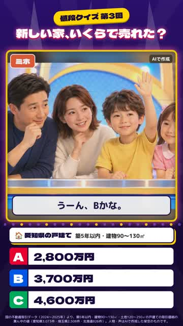
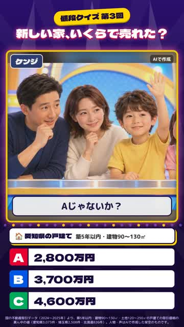
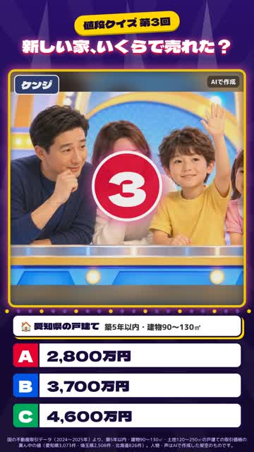
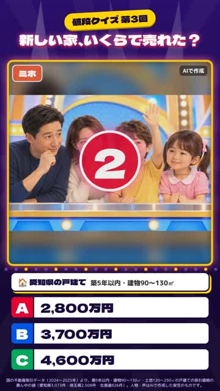
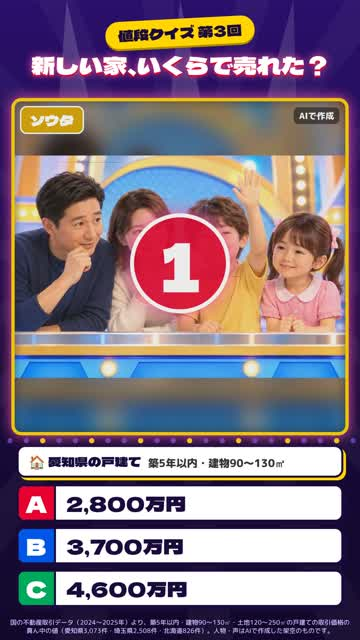
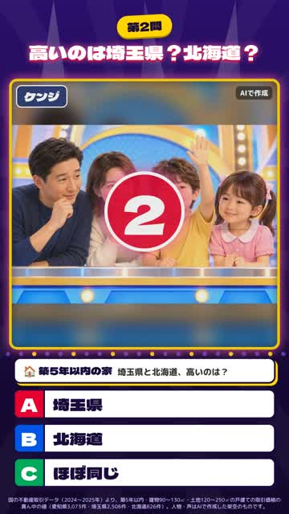

# 4. 絵コンテ：値段クイズ 第3回「新しい家、いくらで売れた？」

全体：本編 58.2 秒 ＋ 最後のチェッカーの紹介 5 秒。1秒25コマ。曲は「昼下がり気分 / KK（OpenTracks）」を小さく、最初から最後まで。
見本の絵は、今の見本（ops/sns/drafts/2026-11-18/Q03.mp4）から各カットを切り出したもの。人物の場面は、のぼるさんのパソコンで自然な動きに作り直す。

| カット | 秒 | 画面（誰が・何を・カメラ） | セリフ | 下の文字 | 音 | 見本 |
|---|---|---|---|---|---|---|
| 1 | 0.0〜4.8 | 司会者のアップ。ゆっくり寄る。話す口と頭が動く | 司会「値段クイズ！ 愛知県の、築5年以内の家。いくらで売れたでしょう？」 | 問題1と選択肢 A/B/C | シュッ |  |
| 2 | 4.8〜10.4 | 司会者のアップ。ゆっくり寄る。話す口と頭が動く | 司会「A 2,800万円／B 3,700万円／C 4,600万円！」 | 問題1と選択肢 A/B/C |  |  |
| 3 | 10.4〜12.9 | 家族4人（相談の絵）、ソウタのほうへゆっくり寄る。ソウタの口が動き、ほかの3人もまばたき・うなずき | ソウタ「Cでしょ！ 新しいもん！」 | 問題1と選択肢 A/B/C |  |  |
| 4 | 12.9〜14.8 | 家族4人（相談の絵）、ミホのほうへゆっくり寄る。ミホの口が動き、ほかの3人もまばたき・うなずき | ミホ「うーん、Bかな。」 | 問題1と選択肢 A/B/C |  |  |
| 5 | 14.8〜15.9 | 家族4人（相談の絵）、ケンジのほうへゆっくり寄る。ケンジの口が動き、ほかの3人もまばたき・うなずき | ケンジ「Aじゃないか？」 | 問題1と選択肢 A/B/C |  |  |
| 6 | 15.9〜16.6 | 家族4人（相談の絵）を少しずつ寄る。大きな数字「3」 | （なし） | 問題1と選択肢 A/B/C | カチッ |  |
| 7 | 16.6〜17.3 | 家族4人（相談の絵）を少しずつ寄る。大きな数字「2」 | （なし） | 問題1と選択肢 A/B/C | カチッ |  |
| 8 | 17.3〜18.0 | 家族4人（相談の絵）を少しずつ寄る。大きな数字「1」 | （なし） | 問題1と選択肢 A/B/C | カチッ |  |
| 9 | 18.0〜21.0 | 司会者のアップ。ゆっくり寄る。話す口と頭が動く | 司会「正解は、B！ 3,700万円です！」 | 選択肢の正解が光る | ピンポン＋紙吹雪 |  |
| 10 | 21.0〜23.2 | 家族の大喜びの絵、ミホに少し寄る | ミホ「やった、また当たった！」 | 選択肢の正解が光る |  |  |
| 11 | 23.2〜25.2 | 家族のびっくりの絵、ソウタに少し寄る | ソウタ「えー、外れた！」 | 選択肢の正解が光る |  |  |
| 12 | 25.2〜33.9 | 司会者のアップ。ゆっくり寄る。話す口と頭が動く | 司会「第2問！ 新しい家、高いのは埼玉県？北海道？」 | 問題2と選択肢 A/B/C | シュッ |  |
| 13 | 33.9〜35.3 | 家族4人（相談の絵）、ハナのほうへゆっくり寄る。ハナの口が動き、ほかの3人もまばたき・うなずき | ハナ「さいたま！」 | 問題2と選択肢 A/B/C |  |  |
| 14 | 35.3〜36.4 | 家族4人（相談の絵）、ケンジのほうへゆっくり寄る。ケンジの口が動き、ほかの3人もまばたき・うなずき | ケンジ「埼玉だろ。」 | 問題2と選択肢 A/B/C |  |  |
| 15 | 36.4〜38.8 | 家族4人（相談の絵）、ミホのほうへゆっくり寄る。ミホの口が動き、ほかの3人もまばたき・うなずき | ミホ「ほぼ同じ、だったりして。」 | 問題2と選択肢 A/B/C |  |  |
| 16 | 38.8〜39.5 | 家族4人（相談の絵）を少しずつ寄る。大きな数字「3」 | （なし） | 問題2と選択肢 A/B/C | カチッ |  |
| 17 | 39.5〜40.2 | 家族4人（相談の絵）を少しずつ寄る。大きな数字「2」 | （なし） | 問題2と選択肢 A/B/C | カチッ |  |
| 18 | 40.2〜40.9 | 家族4人（相談の絵）を少しずつ寄る。大きな数字「1」 | （なし） | 問題2と選択肢 A/B/C | カチッ |  |
| 19 | 40.9〜48.2 | 司会者のアップ。ゆっくり寄る。話す口と頭が動く | 司会「正解は、C！ 埼玉県3,600万円、北海道3,700万円。ほぼ同じ！」 | 答えの棒グラフ | ピンポン＋紙吹雪 |  |
| 20 | 48.2〜50.7 | 家族のびっくりの絵、ケンジに少し寄る | ケンジ「北海道のほうが、高いのか！」 | 答えの棒グラフ |  |  |
| 21 | 50.7〜53.9 | 家族4人（相談の絵）、ミホのほうへゆっくり寄る。ミホの口が動き、ほかの3人もまばたき・うなずき | ミホ「新しい家は、どこも高いんだね。」 | 「気になる家の値段」の札 |  |  |
| 22 | 53.9〜58.2 | 司会者のアップ。ゆっくり寄る。話す口と頭が動く | 司会「何問正解できたかな？ コメントで教えてね！」 | 「気になる家の値段」の札 |  |  |
| 最後 | +5秒 | チェッカーの実際の画面。「スクショを貼るだけ」「国の取引データで参考価格」「無料・登録不要」の札がポンと出る | 司会「気になる家の値段は、お買い得物件チェッカーで、無料でチェック！」 | 「プロフィールのリンクから ▶」 | — | `ops/sns/video/Q01/avatar/end.html` |

## のぼるさんのパソコンで作るもの（人物が自然に動く場面）
- 司会者の各セリフ：`host-chatgpt.png` から、セリフの長さの動画を作り、口をセリフの声（`ops/sns/drafts/2026-11-18/src/q03/voice/` の声。クラウド側で用意）に合わせる
- 家族の各セリフ：相談の絵から動きを作り、話す人の口を声に合わせる
- 大喜び・びっくり：それぞれの絵から2〜3秒の動き（声なしでよい）
- 3・2・1：相談の絵から3秒ほどの、考えている動き
